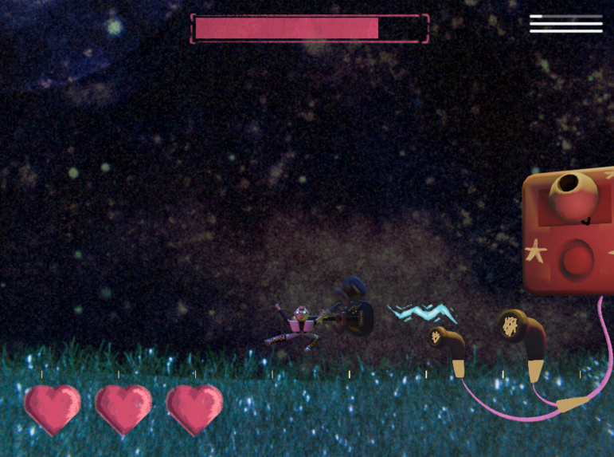

# SpacePunk

An evil retro 2000's Apple iPod is out to steal your music! You play as a Space Punk, who fights with a guitar, while using a real-life electric guitar as your controller. A whimsical 2D fighting game.

Implemented in Unity, using a custom [Discrete Fourier Transform](https://en.wikipedia.org/wiki/Discrete_Fourier_transform) to create a spectrogram and analyse harmonics to differentiate guitar input.

This was a [HackNotts '26](https://web.archive.org/web/20261025120357/https://hacknotts.com/) hackathon project, made entirely in 25 hours in a team of four people.

[Devpost](https://devpost.com/software/spacepunk)

We are a team of four:

- [Elia Wiekiera](https://github.com/Eliiia) (BSc CS @ UoN)
- [Aryan Kumar](https://github.com/ary1k) (BSc CS @ UoN)
- [Dawson Taylor](https://github.com/UniverseSquared) (MSci CS @ UoN)
- [Kabien Kitchen](https://github.com/Kabaffle) (BA Games Art @ MMU)

## Demo

https://youtu.be/7xlwJ75gBqY

## To run

- Have guitar data flowing in through your default microphone
  - e.g. through an audio interface, a piped file, etc
- Run the game through unity
- Use your E string to move (different frets = different locations)
- Use open strings E, G, and B for different actions
